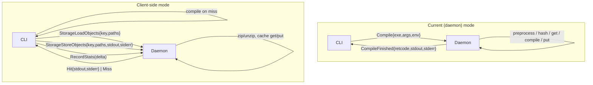

# sccache client-side mode

## Motivation

In the current architecture (see [ProcessArchitecture.md](ProcessArchitecture.md)) every compile
request — preprocessing, hashing, cache I/O, and compilation — runs inside the single daemon
process. Under a parallel build (`make -jN`) all N invocations serialise through one event loop
and one process address space. This creates a bottleneck: the work is CPU-parallel, but the
daemon handles it sequentially per request.

**Client-side mode** moves the compile pipeline into each short-lived CLI process while keeping
the daemon as a storage proxy. Preprocessing and compilation spread naturally across cores; only
cache I/O is centralised.

---

## Architecture comparison



---

## The seam: `CompilationCache` trait

Today `CompilerHasher::get_cached_or_compile` (`compiler.rs:520`) drives the pipeline through
`Arc<dyn Storage>`:

```
storage.get(key)          → CacheRead → extract_objects(paths)
CacheWrite::from_objects(paths) → storage.put(key, entry)
```

Client-side mode introduces a **`CompilationCache` trait** that wraps this sequence and exposes
path-level operations. `get_cached_or_compile` is updated to take `Arc<dyn CompilationCache>`
instead.

### `CompilationCache` trait surface

```rust
pub enum LoadResult {
    Hit { stdout: Vec<u8>, stderr: Vec<u8> },
    Miss,
}

#[async_trait]
pub trait CompilationCache: Send + Sync {
    // Core cache operations
    async fn load_objects(
        &self, key: &str, outputs: Vec<FileObjectSource>, pool: &Handle,
    ) -> Result<LoadResult>;
    async fn store_objects(
        &self, key: &str, outputs: Vec<FileObjectSource>,
        stdout: Vec<u8>, stderr: Vec<u8>, pool: &Handle,
    ) -> Result<()>;  // no Duration — caller times with Instant::now()

    // Preprocessor cache (direct mode, disk-only)
    async fn get_preprocessor_cache_entry(
        &self, key: &str,
    ) -> Result<Option<PreprocessorCacheEntry>>;
    async fn put_preprocessor_cache_entry(
        &self, key: &str, entry: PreprocessorCacheEntry,
    ) -> Result<()>;

    // Sync getters (cached at construction; never block)
    fn location(&self) -> String;
    fn cache_type_name(&self) -> &'static str;
    fn basedirs(&self) -> &[Vec<u8>];
    fn preprocessor_cache_mode_config(&self) -> PreprocessorCacheModeConfig;

    // Async runtime state
    async fn check(&self) -> Result<CacheMode>;
    async fn current_size(&self) -> Result<Option<u64>>;
    async fn max_size(&self) -> Result<Option<u64>>;
}
```

The `Storage` trait and every backend are **not changed**.

### `LocalCompilationCache` (daemon mode)

Wraps `Arc<dyn Storage>`. Implements `load_objects` / `store_objects` by calling the existing
`storage.get` → `CacheRead::extract_objects` and `CacheWrite::from_objects` → `storage.put`
sequence. The daemon constructs this at startup and wraps it in `Arc<dyn CompilationCache>`.

### `IpcCompilationCache` (client-side mode)

Wraps a `ServerConnection` to the daemon. Object bytes never cross IPC — only path strings and
small stdout/stderr buffers are sent. The daemon's handler uses its `LocalCompilationCache` to
perform zip/unzip and storage I/O locally.

---

## Wire protocol additions

Six new `Request` / `Response` variants are added to `protocol.rs`. All are single-round-trip
(`Message::WithoutBody`).

| Request | Response |
|---|---|
| `StorageHandshake` | `StorageHandshakeInfo { location, cache_type_name, basedirs, preprocessor_cache_mode_config, cache_mode, max_size }` |
| `StorageLoadObjects { key, outputs: Vec<FileObjectSource> }` | `LoadObjectsResponse` (`Hit { stdout, stderr }` \| `Miss` \| `Err(String)`) |
| `StorageStoreObjects { key, outputs, stdout, stderr }` | `Result<(), String>` |
| `StorageGetPreprocessorEntry { key }` | `Result<Option<Vec<u8>>, String>` (bincoded entry) |
| `StoragePutPreprocessorEntry { key, entry_bytes }` | `Result<(), String>` |
| `RecordStats(StatsDelta)` | `()` |

**`StorageHandshake`** is sent once when `IpcCompilationCache` is constructed; the response
populates the cached sync-getter values (`location`, `basedirs`, etc.) so subsequent calls never
block on a round trip.

**`StorageLoadObjects` / `StorageStoreObjects`** carry path strings only. The daemon opens and
writes output files directly via the existing `CacheRead::extract_objects` /
`CacheWrite::from_objects` helpers. The client and daemon share the same filesystem (same user,
same host), so no file content crosses IPC.

**`RecordStats`** is sent at the end of each invocation so that `--show-stats` remains accurate.
The daemon-side `StorageStoreObjects` handler does *not* increment `cache_writes` — that counter
comes exclusively from the client's `RecordStats` delta to avoid double-counting.

---

## What is NOT sent over the wire

- `CacheRead` / `CacheWrite` zip archives.
- Compiled object file bytes.
- Preprocessed source text.
- Any content of input or output files.

Only path strings, small stdout/stderr capture buffers (typically a few KB of diagnostics), and
small bincoded preprocessor-cache entries (~KB) cross IPC.

---

## Per-invocation compile pipeline (client-side mode)

```
CLI process
 ├─ connect_or_start_server()
 ├─ IpcCompilationCache::connect(conn) → StorageHandshake RPC
 ├─ SccacheService::new_client_side(Arc::new(ipc_cache), ...)
 └─ service.handle_compile(...)
     ├─ compiler_info()          re-detected per invocation
     ├─ check_compiler()
     └─ start_compile_task()
         └─ get_cached_or_compile()
             ├─ generate_hash_key (preprocess + hash, runs here)
             ├─ cache.load_objects(key, paths)  ──► daemon: cache get + file write
             ├─ [on Miss] compile locally
             └─ cache.store_objects(key, paths, stdout, stderr)  ──► daemon: file read + cache put
 └─ RecordStats(delta) RPC
```

### Compiler detection

`compiler_info` is re-run per invocation rather than cached in the daemon. Serialising detected
`Compiler` trait objects (which contain `Box<dyn CompilerProxy>` for rustup shims, etc.) over
IPC is impractical, and a `GetCompilerInfo` RPC would re-introduce per-request daemon contention
on cold builds.

### Statistics

Each invocation accumulates a local `ServerStats`, then ships a `RecordStats(StatsDelta)` RPC
before exit. `--show-stats` is served by the daemon and reflects the merged totals; its output
is unchanged.

---

## Daemon behaviour

The daemon serves both `Compile` RPCs (legacy mode) and storage RPCs (client-side mode)
simultaneously. No parallel codepath is required: the storage RPC handlers call
`self.cache.load_objects` / `self.cache.store_objects` on the same `LocalCompilationCache`
instance the daemon already owns.

When `client_side_mode` is enabled, the daemon may optionally respond to `Compile` requests with
`UnhandledCompile` immediately, but this is not required for correctness.

---

## Configuration

```toml
# ~/.config/sccache/config
[server]
client_side_mode = true
```

Or via environment variable:

```
SCCACHE_CLIENT_SIDE=1
```

The CLI and daemon must agree on the mode. The daemon does not enforce this; a mismatch simply
means the daemon receives the new storage RPCs while the CLI constructs `IpcCompilationCache`.

### Logging

Because the pipeline runs in the CLI, so does most of the logging: under
`make -jN` there are N+1 processes writing to one log destination. Rather than
disabling logging in client-side mode, each line is made attributable (it carries
the emitting pid, and every invocation logs its argv at `debug` level) and atomic
(one `write_all`, hence one `write` syscall, per line). `SCCACHE_ERROR_LOG` is
honored by the CLI too, opened `O_APPEND` so concurrent appends are serialised;
only log output is redirected, since the CLI's stderr carries the compiler's
diagnostics. See the [architecture doc](Architecture.md#logging).

### Tokio runtime sizing

In client-side mode the CLI runtime is built with `worker_threads(2)` instead of the default
`num_cpus`. Under `make -jN`, spawning N processes each with `num_cpus` threads wastes resources.
Two async workers per process are sufficient for one preprocess + one compile + a handful of IPC
round-trips; the blocking thread pool handles zstd/zip work.
